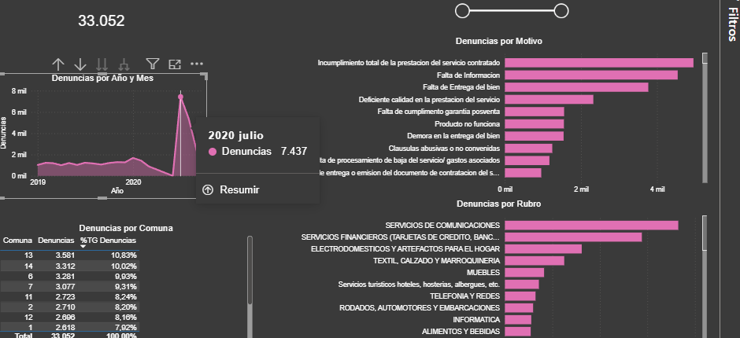
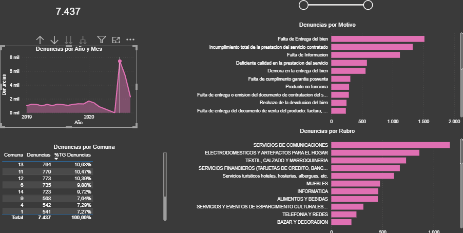

# Pico de denuncias en julio 2020

Hallazgo complementario del análisis principal (ver [README](README.md)).

---

## Qué pasó

En julio de 2020 se registraron **7.437 denuncias**, contra **1.232 en julio de 2019**: unas 6 veces más. Es el pico más alto de todo el período analizado y concentra el 22,5% de las 33.052 denuncias del total (y casi 4 de cada 10 de las 19.133 registradas en 2020 hasta el 30/09).

---

## Cómo se analizó

1. Se filtró el punto más alto del gráfico de denuncias por año y mes (julio 2020).
2. Se comparó el ranking de motivos y rubros de ese mes con el de un mes normal del año anterior (julio 2019) y con el total general.
3. Lo que cambia de posición entre un ranking y otro es lo que explica el pico. Lo que queda igual, no lo explica.

---

## Qué cambió adentro

- **Motivo:** en julio 2019 lideraba el incumplimiento de promociones. En julio 2020 pasa al primer lugar la **falta de entrega del bien** (alrededor de 1.500 denuncias ese mes, según el gráfico), un motivo que en 2019 figuraba mucho más abajo. En el total 2019-2020 combinado ocupa el tercer lugar, por lo que el aumento se concentra en ese mes.
- **Rubro:** Servicios de comunicaciones encabeza tanto el total como julio 2020, así que no explica el pico. Electrodomésticos y Textil ganan peso en julio 2020, lo que es coherente con un problema de entrega de bienes. Servicios financieros, segundo en el total, baja al cuarto lugar ese mes.
- **Comuna:** el reparto se mantiene parejo. En julio 2020 ninguna comuna supera el 10,7% de las denuncias (la comuna 13 lidera con 10,68%, similar a su 10,83% del total), por lo que el pico se dio en toda la ciudad y no en una zona puntual.

---

## Hipótesis

El patrón no muestra un aumento gradual desde el inicio del ASPO (20/03): marzo tiene 890 denuncias, abril y mayo no figuran, junio tiene 3 y julio 7.437. Con falta de entrega del bien pasa lo mismo (36 en marzo, 1 en junio y 1.516 en julio). Esto sugiere que el pico de julio puede deberse en parte a cómo se registraron las denuncias (por ejemplo, cargas acumuladas durante el aislamiento) y no solo a un aumento real de reclamos. Es una hipótesis: el dataset no permite confirmarlo.

---

## Próximos pasos

Buscar en la documentación del dataset si hay algún aviso sobre el registro entre abril y junio de 2020.
Verificar si otros motivos muestran el mismo patrón (casi sin denuncias de abril a junio y pico en julio).

---

**Herramientas:** Power BI y DAX. Fuente de datos: ver README principal.
